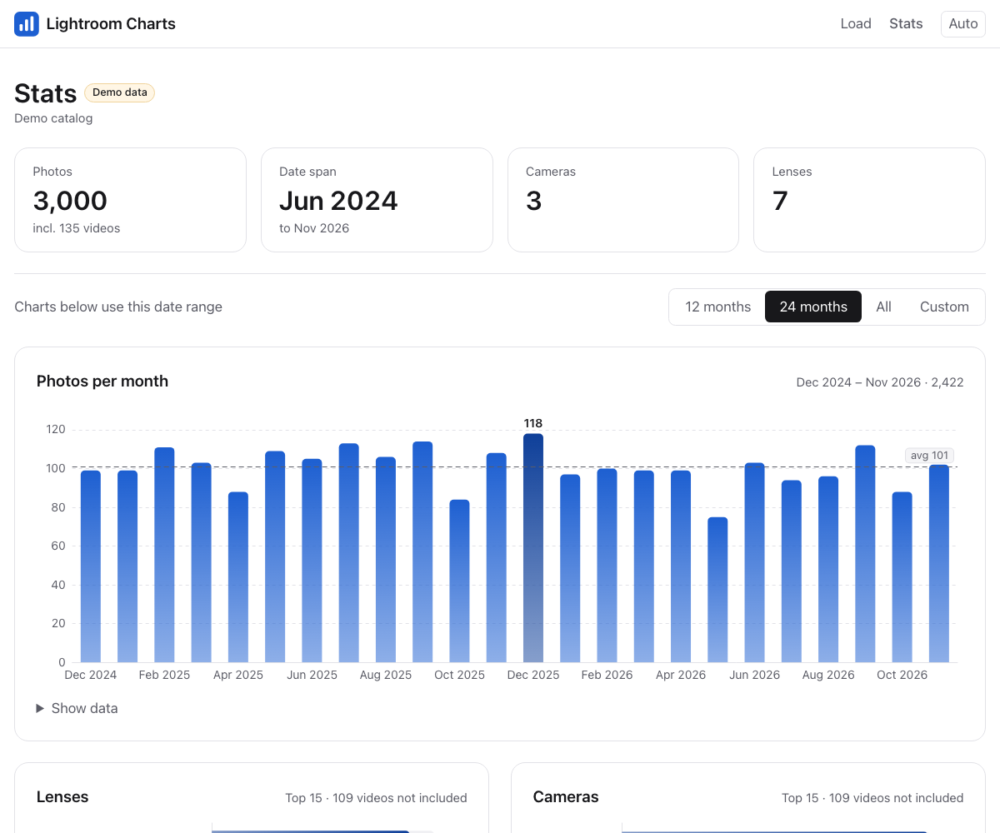
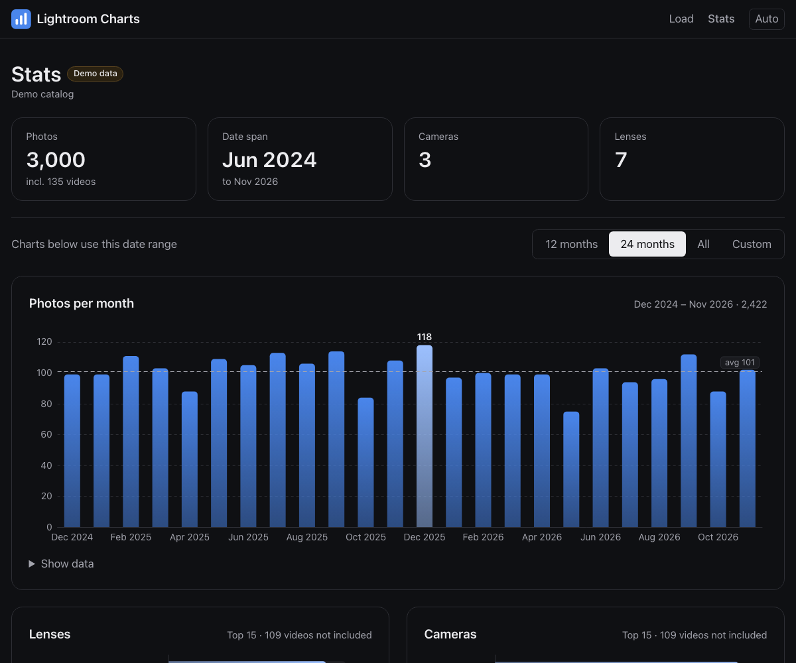
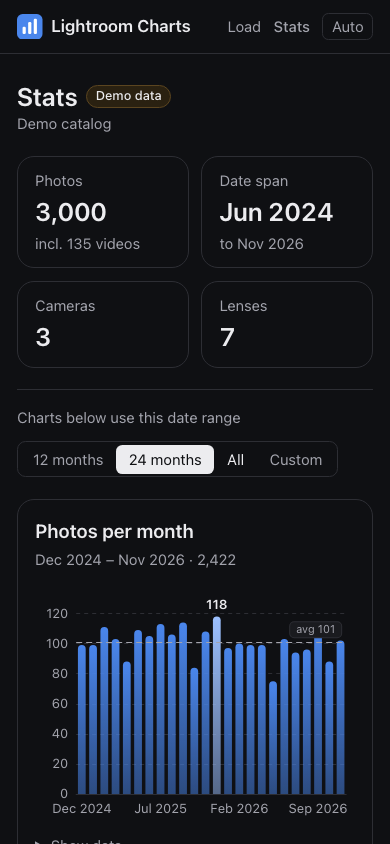
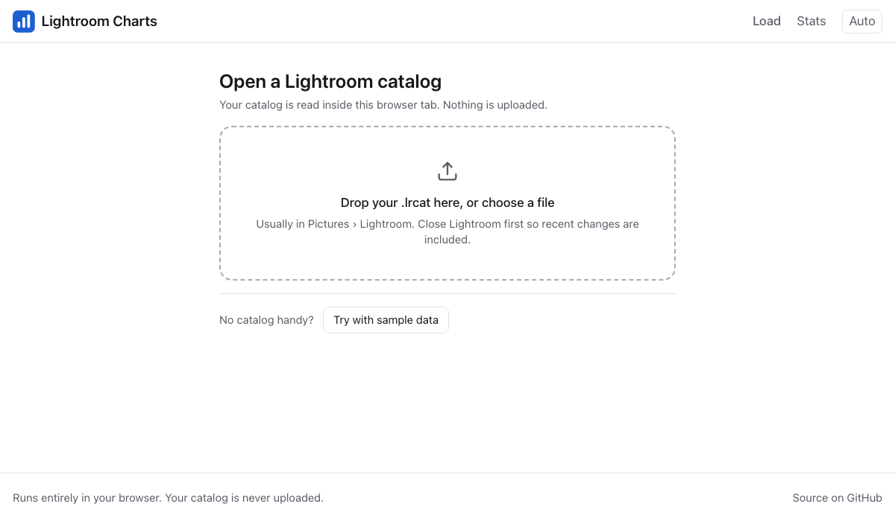

# Lightroom Charts

Local, privacy-first photo analytics. Open a Lightroom Classic catalog (`.lrcat`) in your browser and explore charts about your photos — the file is read entirely on your machine and never uploaded.

**Live:** https://umibri.github.io/lightroom-charts/



<details>
<summary>Dark mode, phone and the Load page</summary>







</details>

Screenshots use the built-in sample data. Regenerate with `SCREENSHOTS=1 npx playwright test screenshots --project=desktop`.

> Close Lightroom before loading your catalog. While Lightroom is open, recent edits can sit in the `.lrcat-wal` side file, which this app does not read.

## How it works

There is no backend. The catalog is a SQLite database; the app opens it with [sql.js](https://github.com/sql-js/sql.js) (SQLite compiled to WebAssembly) inside a Web Worker and runs read-only queries there, so the UI thread stays responsive.

```
UI (React)  ──Comlink──▶  Web Worker  ──▶  sql.js (WASM SQLite, in-memory copy of the catalog)
```

## What you get

- Photos per month for the selected range (empty months shown as zero)
- Top 15 lenses and cameras
- Exposure: ISO, aperture and shutter speed by full stop, and focal length (mm as recorded, not 35mm-equivalent)
- When you shoot: photos by hour of day and by day of week (local time, as Lightroom stores it)
- Date range: last 12 or 24 months of the catalog (default 24; ending at your latest photo if that's before today), all time, or a custom month range; kept in the URL so back/forward and refresh-after-load keep your view
- "Show data" under every chart lists the exact numbers (also read by screen readers)
- **Reopen** your last catalog without picking it again (Chrome and Edge on desktop). The browser keeps a permission handle to the file in its own storage, not the file's contents; it asks you to allow reading the file again, and **Forget** removes it. Other browsers simply don't show the option.
- No catalog handy? **Try with sample data** generates a demo catalog in the browser (works offline) and marks the page **Demo data**

## How photos are counted

The rules live in `src/catalog/` and are covered by tests against synthetic catalogs.

- **Virtual copies are excluded.** They are the same photo (`Adobe_images.masterImage` is set).
- **Videos are included** in totals, the timeline and the time-of-day charts, but left out of the camera, lens and exposure charts (Lightroom records no camera EXIF for them); those charts say how many were left out.
- **Months come from the capture time as written** (`YYYY-MM` of `captureTime`). Lightroom stores local wall-clock time without a zone, so no timezone conversion is applied.
- **Photos without a capture date** are counted in the summary but not in timelines or date-filtered views.
- **Missing or blank camera/lens/ISO** is shown as `[Unknown]`, which sorts after named values on ties.
- **One EXIF row per photo**, so a photo is never counted twice.
- **Exposure values** are stored by Lightroom as APEX values and grouped by nearest full stop (e.g. f/1.8 counts as f/2, 1/200 s as 1/250). A shutter value of 0 is a genuine 1-second exposure.
- **Schema checks on open.** Lightroom's catalog format is undocumented. The app detects whether EXIF rows point at the image id or the file id, and warns if over half the photos have no matching camera/lens data or no readable capture date, instead of silently charting `[Unknown]`. `npm run inspect` prints the same checks as a "Health" block.

To check against your own catalog, close Lightroom and run `npm run inspect -- path/to/catalog.lrcat`, then compare with Lightroom's Library filter bar (Metadata → Capture Date / Camera / Lens).

## Limits

The whole catalog is held in memory. Opening needs about 2× the file size briefly, then about 1×. A 1 GB catalog opened in under 5 seconds in Chrome in testing; larger catalogs depend on the browser and the device's memory.

## Tech stack

- **Build/UI:** Vite 8 · React 19 · TypeScript 5.9
- **Styling:** Tailwind CSS 4
- **Routing:** TanStack Router (hash history, so deep links work on GitHub Pages)
- **DB (browser):** sql.js in a Web Worker via Comlink
- **Charts:** Apache ECharts (bar charts only, tree-shaken)
- **Data loading:** TanStack Query (cache keyed by catalog + date range)
- **Tests:** Vitest (logic) · Playwright (browser, desktop + phone)
- **Quality:** ESLint 10 (flat config) · Prettier 3 · Husky + lint-staged
- **CI/CD:** GitHub Actions — checks on every PR, deploy to GitHub Pages on `main`

## Getting started

Requires Node 22.22+ (see `.nvmrc`).

```bash
npm install
npm run dev
```

| Script                               | What it does                                                          |
| ------------------------------------ | --------------------------------------------------------------------- |
| `npm run dev`                        | Dev server                                                            |
| `npm run build`                      | Typecheck + production build to `dist/`                               |
| `npm run preview`                    | Serve the production build locally                                    |
| `npm test`                           | Unit tests (Vitest)                                                   |
| `npm run e2e`                        | Browser tests (Playwright) on the production build, desktop and phone |
| `npm run lint`                       | ESLint                                                                |
| `npm run format`                     | Prettier (write)                                                      |
| `npm run verify`                     | Lint, format check, tests, build (pre-push)                           |
| `npm run inspect -- <file.lrcat>`    | Print the app's numbers for a catalog (same query code)               |
| `npm run fixture -- <out.lrcat> [n]` | Write a synthetic Lightroom-shaped catalog with n photos              |

In dev, `#/debug` shows a schema explorer for the loaded catalog. It is not included in production builds.

## License

MIT — see [LICENSE](LICENSE).
